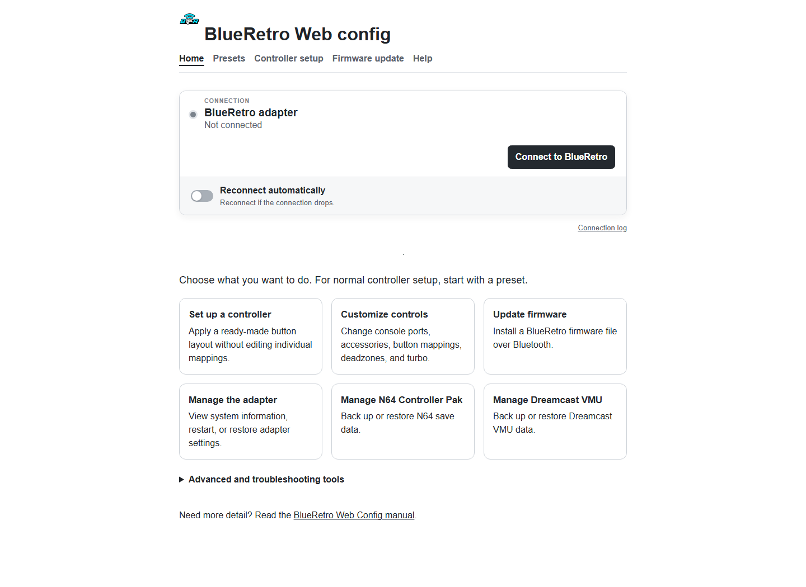

# BlueRetro Web Config guide

This guide covers the tasks available in this Web Config frontend. It intentionally leaves out hardware construction, cable wiring, USB flashing, and firmware development.

> **Can't find what you need?** These guides focus on Web Config. See the [original BlueRetro wiki](https://github.com/darthcloud/BlueRetro/wiki) for hardware installation, wiring, USB flashing, development, and other topics not reproduced here.

## Start here

1. Power on the BlueRetro adapter with no controller connected.
2. Open the Web Config in Chrome or Edge and select **Connect to BlueRetro**.
3. Choose the adapter in the browser prompt. The page will show its firmware, hardware revision, and platform.
4. Choose what you need:

| Goal | Tool |
| --- | --- |
| Use a common controller layout | **Presets** |
| Change ports, accessories, or individual buttons | **Controller setup** |
| Install a `.bin` firmware file | **Firmware update** |
| Restart, sleep, or reset the adapter | **Manage the adapter** |
| Back up or restore N64 or Dreamcast saves | **N64 Controller Pak** or **Dreamcast VMU** |
| Collect information for support | **Connection log** or **Device trace** |

Configuration mode is available only while controllers are disconnected from BlueRetro. If the adapter does not appear in the browser prompt, turn off connected controllers and try again.

## Important connection behavior

- Moving between tools on this page keeps the current Web Bluetooth connection.
- **Reconnect automatically** can recover a dropped connection while the page remains open.
- Refreshing or closing the page ends the browser session. Connect manually after reopening it.
- Turn automatic reconnection off when you are finished configuring so the adapter is free to reconnect to controllers.

## Guides

- [Pair a controller](pairing.md)
- [Configure controllers and accessories](configuration.md)
- [Update firmware and recover](firmware.md)
- [Technical reference](technical-reference.md)

These pages condense the Web Config portions of the original [BlueRetro wiki](https://github.com/darthcloud/BlueRetro/wiki) for this reworked frontend.
