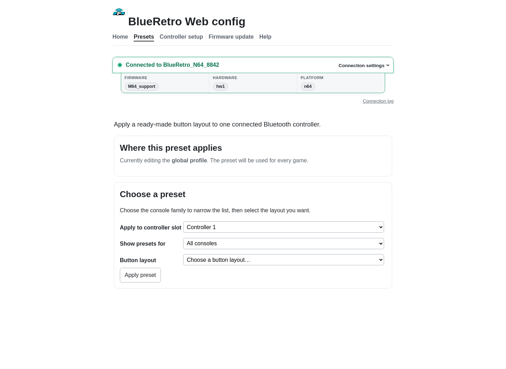
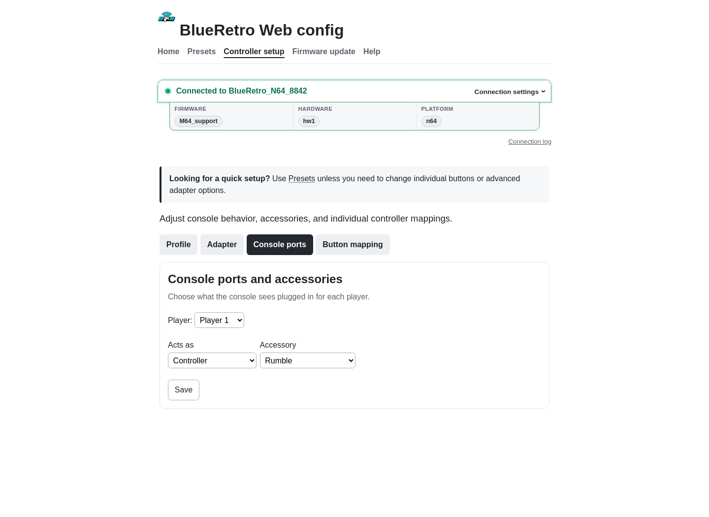
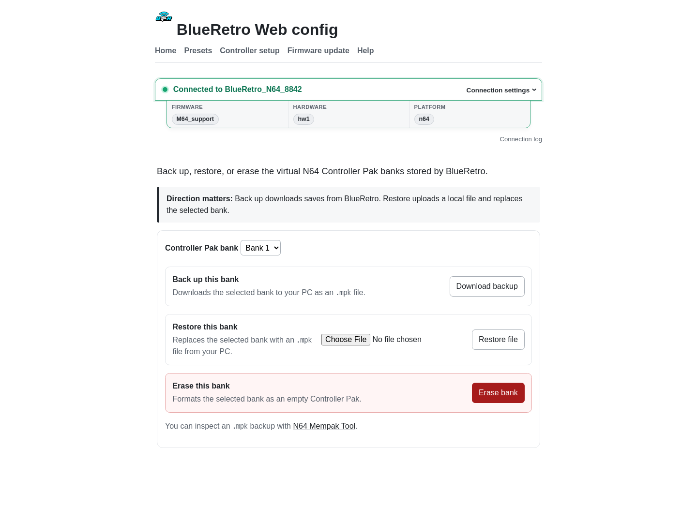

# Configure controllers and accessories

[Documentation home](README.md) · [Pairing](pairing.md) · [Technical reference](technical-reference.md)

Connect Web Config while no controller is connected to BlueRetro. Most users should start with **Presets** and use **Controller setup** only when a preset does not provide the desired layout.

## Apply a preset

1. Open **Presets**.
2. Choose the global profile or the currently running game's profile.
3. Choose the Bluetooth controller number.
4. Optionally filter by console, then choose a layout.
5. Save and repeat for each additional controller.

The global profile is used everywhere unless a supported game loader supplies a GameID with its own profile.

## Controller setup

### Profile

Choose whether edits apply globally or only to the current GameID. Use global unless you deliberately want a game-specific layout.

### Adapter

These settings affect the whole adapter:

- **Console:** leave auto-detect enabled unless the adapter cannot identify the target.
- **Multitap:** enable only for the appropriate console and game.
- **Pairing mode:** automatic starts inquiry when no controller is connected; manual requires the adapter button.
- **Memory bank:** selects the first N64 Controller Pak bank. Later players cascade from it.

Restart the adapter after saving adapter-wide changes.

### Console ports

Choose a player, what the console should see on that port, and its accessory. Save each player separately.

Common accessory choices include **Rumble Pak**, **Controller Pak**, or both where the firmware and console support them. For an M64 Pro controller, choose **Rumble Pak** to route N64 rumble to its built-in motor.

### Button mapping

Choose the Bluetooth controller and labels that match the source controller and destination console. For a simple remap, change only:

- **From:** the controller button or axis.
- **To:** the console button or axis.

Leave scaling, thresholds, deadzones, and turbo at their defaults unless you are solving a specific input problem. Save each Bluetooth controller separately.

## Save-memory tools

### N64 Controller Pak

BlueRetro provides four banks. Select a bank, then:

- **Download backup** saves an `.mpk` copy to the computer.
- **Restore file** overwrites the selected bank from an `.mpk` file.
- **Erase bank** creates a newly formatted bank and removes its current saves.

Back up a bank before restoring or erasing it. BlueRetro does not initialize a new Controller Pak automatically; format it here or from a compatible game.

### Dreamcast VMU

Use **Download backup** or **Restore file** for the adapter's single VMU image. Format a new VMU from the Dreamcast BIOS. Do not assign the same VMU to multiple active players because concurrent writes can corrupt it.

## Stored files

The **Files** tool is intended for advanced cleanup of adapter files and GameID profiles. Default files are recreated at startup, but deleting configuration files resets the associated settings. Back up anything important before deleting it.

For field definitions, profile limits, turbo behavior, and adapter indicators, see the [technical reference](technical-reference.md).

Source material: [BlueRetro Web Config manual](https://github.com/darthcloud/BlueRetro/wiki/BlueRetro-BLE-Web-Config-User-Manual) and [system-specific manual](https://github.com/darthcloud/BlueRetro/wiki/BlueRetro-System-Specific-User-Manual).
