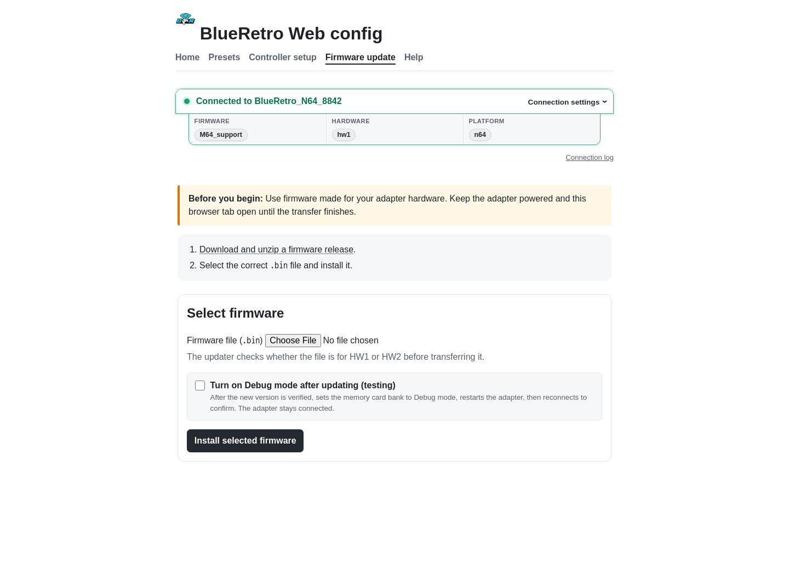

# Update firmware and recover

[Documentation home](README.md) · [Pairing](pairing.md) · [Technical reference](technical-reference.md)

## Before updating

- Download firmware from a trusted BlueRetro release.
- Extract the archive and choose the `.bin` matching the adapter's hardware revision and console platform.
- Disconnect all controllers and connect Web Config to the adapter.
- Keep the console or adapter powered throughout the transfer.

Using firmware for the wrong hardware or interrupting the write can make the adapter unavailable until it is recovered.

## Install over Bluetooth

1. Open **Firmware update**.
2. Select the correct `.bin` file.
3. Select **Install selected firmware**.
4. Leave the page open until the transfer reaches 100% and the adapter restarts itself.
5. The frontend makes a one-time reconnection attempt and compares the running version with the uploaded file.

Do not manually restart the adapter during the update. If verification succeeds, the frontend disconnects and forgets the Web Bluetooth device so controllers can reconnect normally. If verification fails, leave the result visible and open the connection log before retrying.

## M64 support firmware

Use the [M64 support release](https://github.com/rainthefrog/BlueRetroForever/releases/tag/M64_Support) for the ModRetro M64 Pro controller. It is based on [bherdm/BlueRetroForever](https://github.com/bherdm/BlueRetroForever), the active continuation of the archived BlueRetro firmware. Choose the archive matching HW1 or HW2, then the N64 firmware binary inside it.

The release adds secure BLE pairing, N64 mapping, and rumble. It has been tested only on an HW1 N64 adapter; other hardware and console targets are unverified.

## Recovery

If the custom firmware prevents normal operation, hold the adapter button for **30 seconds** to restore the factory firmware and reset configuration. Keep holding through the earlier LED patterns until the full recovery interval has elapsed.

Factory recovery removes settings and pairings. Reconnect with Web Config and configure the adapter again afterward.

## Information for troubleshooting

- **Connection log:** browser-side connection, reconnection, and tool activity for the current page session.
- **Device trace:** downloads the firmware trace requested by support.
- **Connected adapter tag:** records the firmware version, hardware revision, and console platform.

When reporting a failure, include those three identifiers, the firmware filename, the point where the transfer stopped, and whether the adapter restarted.

Source material: [BlueRetro firmware-update instructions](https://github.com/darthcloud/BlueRetro/wiki#8---updating-firmware), [Web Config OTA guide](https://github.com/darthcloud/BlueRetro/wiki/BlueRetro-BLE-Web-Config-User-Manual#5---ota-fw-update-page), [BlueRetroForever](https://github.com/bherdm/BlueRetroForever), and the [M64 support release](https://github.com/rainthefrog/BlueRetroForever/releases/tag/M64_Support).
